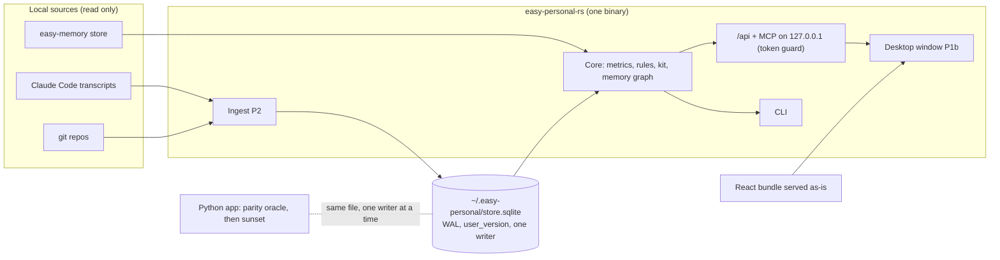

# Main flow

How the Rust app sits next to the Python app during the transition, and how a request flows once it is running.

## Request flow (P1+)
1. The window (or the CLI, or an MCP client) calls `/api/*` or an MCP tool on `127.0.0.1`.
2. The Host/Origin/token guard checks the request.
3. The core reads the store (read-only connection, `busy_timeout`) and answers the same JSON shape as Python.
4. Writes (P2+) go through the single-writer lock; a newer `user_version` than the code knows is refused.
